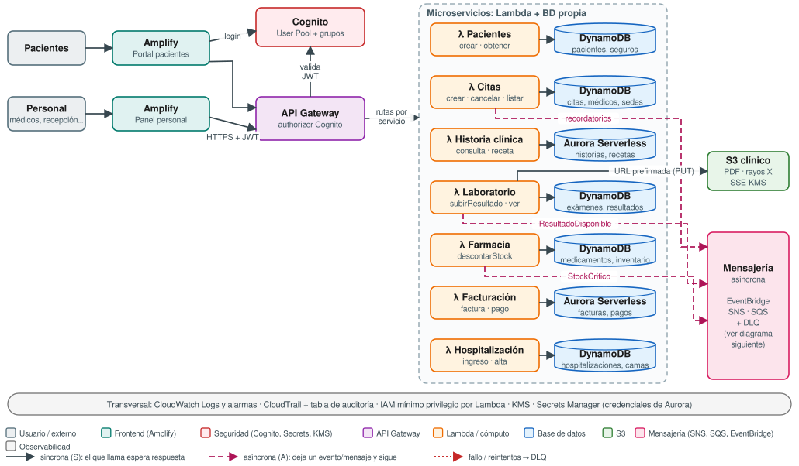
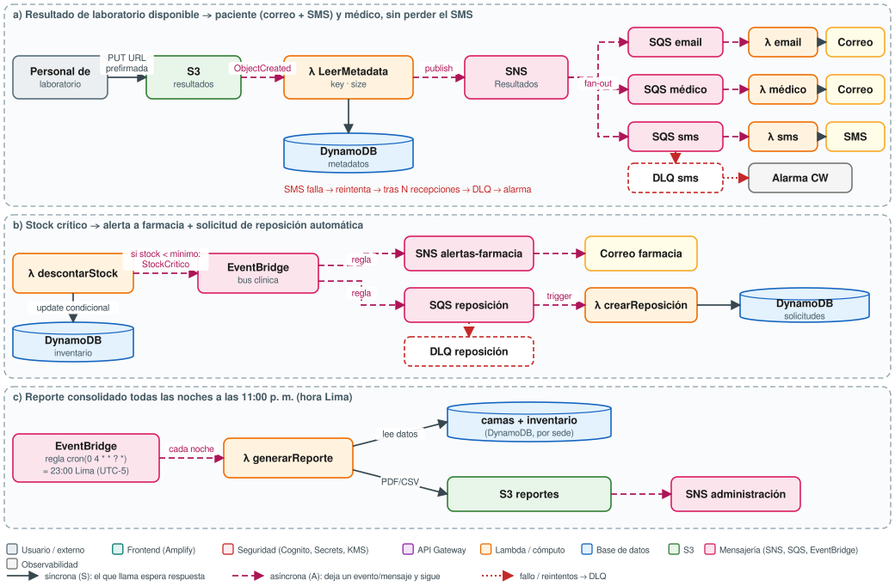
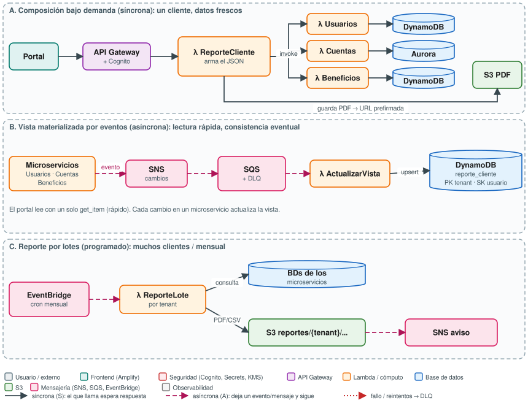

# Guía para el examen de diseño de arquitectura serverless (caso + diagrama)

Basada en el `Examen Final.pdf` simulado (Clínica Hospital San Gabriel: 5 preguntas, 10 pts, 90 min) y en el material de las semanas 9–15 (`estudio/semana-N.md`).

**Convención de fiabilidad** (importante para no escribir en el examen algo que el profesor no dio):

- **[CURSO]** = aparece en teoría o laboratorio. Cítalo con confianza.
- **[EXTRA]** = conocimiento estándar de AWS que **no** aparece en el material (lo marco para que sepas que es tuyo, no del curso). Muchos son necesarios porque el enunciado los pide (p. ej. claims JWT, grupos de Cognito). Verifica los detalles antes de usarlos.
- **[PROPUESTA]** = diseño mío para el caso de la clínica; es un ejemplo de respuesta, no una "solución oficial".

---

## 1. Qué evalúa este tipo de examen

Dado un **caso** (empresa, problemas, requisitos funcionales y no funcionales, modelo de datos), te piden siempre lo mismo:

| Pregunta | Qué piden | Dónde se aprende en el curso |
|---|---|---|
| 1. Microservicios + BD | Dividir en ≥5 microservicios, Lambdas por servicio, tablas que le tocan, DynamoDB vs RDS justificado, dónde van los archivos | Sem. 9 (multi-tenancy, claves DynamoDB), sem. 10 (capas serverless), sem. 11 (proyecto final: "cada microservicio con su propia BD") |
| 2. Diagrama | Frontend, auth, API, Lambdas, BDs, S3, eventos, notificaciones, flechas síncronas/asíncronas | Sem. 10 (ejemplos de arquitecturas), sem. 14 (escenarios del Serverless Lens), sem. 13–14 |
| 3. Eventos | Flujo paso a paso, SQS vs SNS vs EventBridge, DLQ | Sem. 13 (SNS, S3→Lambda→SNS), sem. 14 (SQS, DLQ, filtros, EventBridge) |
| 4. Seguridad | Cognito, authorizer, claims, medidas extra | Sem. 10 (token propio porque Cognito no estaba en AWS Academy), sem. 15 (secretos) |
| 5. Conceptos | Serverless vs EC2, cold start | Sem. 10 (teoría serverless), sem. 11 (cold start) |

La rúbrica del Proyecto Final (sem. 11) refleja lo mismo: **Diagrama de arquitectura = 2/20, BackEnd = 8, FrontEnd = 6**. Requisitos del proyecto que el profesor repite como patrón **[CURSO]**: ≥5 microservicios serverless protegidos (API Gateway + Lambda), **cada uno con su propia BD**; SQL → un único RDS con el **patrón 2 (una BD, varios esquemas)**; NoSQL → DynamoDB; usar además S3, SNS y SQS; frontend en Amplify; despliegue con Serverless Framework; multi-tenancy y EDA.

---

## 2. Método en 10 pasos (úsalo en cualquier caso nuevo)

1. **Subraya los requisitos no funcionales** (volumen, picos, disponibilidad, tamaño de archivos, plazos tipo "24 h antes", "11 p. m.", auditoría). Cada uno justifica un servicio concreto.
2. **Mapea los problemas actuales a servicios**: caídas en horas pico → escalado automático (Lambda/API GW/DynamoDB on-demand); costos fijos → pago por uso; reserva fuera de horario → portal web 24/7; notificaciones → SNS/SQS/EventBridge; resultados en papel → S3 + notificación.
3. **Agrupa las tablas por módulo funcional** → microservicios (una BD por microservicio, sin joins entre servicios).
4. **Elige BD por microservicio** con la tabla de decisión de §4 y justifica con: patrón de acceso, relaciones, transacciones, consistencia.
5. **Define los archivos pesados**: van a S3; la BD guarda solo metadatos + clave del objeto (`bucket`, `key`).
6. **Define identidad**: Cognito (usuarios, grupos), authorizer en API Gateway, y qué claim limita los datos.
7. **Define eventos**: ¿quién publica?, ¿quién consume?, ¿es fan-out (SNS), cola con reintentos (SQS), regla/schedule (EventBridge)? ¿Dónde pones DLQ?
8. **Dibuja** con la plantilla de §6 (de izquierda a derecha, flechas etiquetadas S/A).
9. **Describe los flujos paso a paso** numerados, indicando servicio + por qué.
10. **Cierra con seguridad, observabilidad y costos** (CloudWatch, mínimo privilegio, cifrado) en 3–4 líneas: suma puntos en cualquier pregunta.

**Regla de oro de justificación**: nunca escribas solo el nombre del servicio; escribe *servicio → por qué este y no otro*. El enunciado lo exige ("por qué ese servicio y no otro").

---

## 3. Catálogo de servicios y qué decir de cada uno

Restricción típica del enunciado: **todo serverless, sin EC2 ni contenedores administrados por el equipo**.

| Servicio | Papel en la arquitectura | Qué puedes afirmar [CURSO] |
|---|---|---|
| **AWS Amplify** | Hosting del frontend (portal pacientes y panel personal) | Sem. 10: "Amplify Console + Cognito" en la app web de ejemplo y "Amplify para integrar frontends iOS/Android/web". Proyecto final: frontend desplegado en Amplify |
| **Amazon Cognito (user pools)** | Usuarios, login, tokens | Sem. 14 (Serverless Lens, escenario Web app): *"administración de usuarios; los tokens emitidos por Cognito se usan para autenticar solicitudes a API Gateway"*. Sem. 10: el docente recomienda Cognito para usuarios/passwords/autorización (en AWS Academy no estaba, por eso se hizo token propio con expiración de 60 min) |
| **Amazon API Gateway** | Punto de entrada HTTPS/REST | Sem. 14: autorización integrada, throttling, seguridad, tolerancia a fallos, mapeo de request/response, optimización de rendimiento |
| **AWS Lambda** | Lógica de negocio; una función por operación | Sem. 11: memoria 128–10 240 MB (CPU proporcional; 1769 MB ≈ 1 vCPU), timeout máx. 900 s, concurrencia por defecto 1000 por región/cuenta |
| **DynamoDB** | NoSQL serverless, ms de un dígito, escala a cualquier nivel | Sem. 9: multi-tenant con `tenant_id` como partición; GSI para segundo patrón de acceso; modo bajo demanda |
| **Aurora Serverless / RDS** | Relacional (MySQL/PostgreSQL), escala capacidad automáticamente | Sem. 10 lista "Amazon Aurora Serverless" y "RDS Proxy" en la capa de datos; sem. 11 usa RDS con patrón 2 (esquemas); sem. 15 taller RDS MySQL + secretos |
| **Amazon S3** | Objetos (PDF, rayos X), estáticos | Sem. 10 lista S3 como almacén de objetos; sem. 13 (Taller 2): evento `ObjectCreated` de S3 → Lambda `LeerMetadataArchivo` (lee bucket/key/size) → publica en SNS |
| **Amazon SNS** | Pub/sub, fan-out, A2A y A2P (correo/SMS/push), filtros por atributo | Sem. 13: tipos Estándar/FIFO; suscriptores SQS, Lambda, HTTP/S, Firehose, correo, SMS; política de filtro; DLQ de suscripción |
| **Amazon SQS** | Cola que desacopla y amortigua picos; reintentos; DLQ | Sem. 14: Estándar (al menos una vez, orden de mejor esfuerzo) vs FIFO (orden y procesamiento único); DLQ con "recepciones máximas" |
| **Amazon EventBridge** | Bus de eventos con reglas (filtrado/ruteo) y reglas programadas | Sem. 13: buses de eventos, reglas sobre el cuerpo del evento, destinos; sem. 14: regla "Programar" cada 1 min que invoca una Lambda |
| **Step Functions** | Orquestación de flujos (opcional) | Sem. 10: "organizador visual de flujos"; ejemplo de procesamiento por lotes con EventBridge → Step Functions |
| **CloudWatch** | Logs, métricas, alarmas, Logs Insights | Sem. 12 |
| **Secrets Manager / Parameter Store** | Credenciales de BD | Sem. 15: ambos con cifrado KMS; Secrets Manager con rotación automática |
| **Rekognition, Textract, Comprehend, Polly, Transcribe, Lex** | IA/ML administrada (solo si el caso lo pide) | Sem. 15 |

**Entrega de notificaciones**: SNS cubre SMS y correo **[CURSO]** (suscripción de correo con filtro y confirmación en sem. 13/14). Para correos a destinatarios arbitrarios (pacientes) lo habitual en AWS es **Amazon SES** **[EXTRA, no aparece en el material]**; si dudas, escribe "SNS (correo/SMS), o SES para correo transaccional" y justifica.

### SQS vs SNS vs EventBridge (pregunta casi segura)

| | **SQS** | **SNS** | **EventBridge** |
|---|---|---|---|
| Modelo | Cola (el consumidor jala o Lambda trigger) | Pub/sub: empuja a todos los suscriptores | Bus de eventos con reglas |
| Uso según el curso | Comunicación **confiable y duradera** entre microservicios; amortigua picos; reintentos + DLQ | **Fan-out** de un mensaje a muchos; notificación a personas (correo/SMS) | **Filtrado y ruteo** de eventos por reglas; eventos de servicios AWS/SaaS/apps propias; **programación** (cron/rate) |
| Filtrado | No | Política de filtro por atributos del mensaje | Reglas sobre todo el cuerpo del evento |
| Persistencia del mensaje | Sí, hasta que se consume | No guarda: entrega y listo (por eso se combina con SQS) | No es cola |
| Patrón típico | Productor → cola → trabajador | Productor → tema → N colas/lambdas/correos | Fuente → bus → reglas → targets |

Combinación recomendada **[CURSO]**: **SNS + SQS (fan-out)**: el servicio publica una vez en SNS y cada consumidor tiene su propia cola SQS, así uno lento o caído no bloquea a los demás y los mensajes no se pierden. Cuando SNS entrega a SQS, la cola necesita una **política de acceso** que permita a SNS escribir (sem. 14, Taller 4).

**DLQ [CURSO]**: se configura en la cola **origen** (opción "Cola de mensajes fallidos", ARN de la DLQ, **recepciones máximas** 1–1000; en el taller = 2). Si un mensaje se recibe más veces que ese máximo sin ser borrado, pasa a la DLQ para análisis/reproceso. SNS también admite DLQ para suscriptores no disponibles.

---

## 4. Tablas de decisión

### DynamoDB vs RDS/Aurora Serverless

| Criterio | DynamoDB | RDS / Aurora Serverless |
|---|---|---|
| Patrón de acceso | Conocido de antemano (por clave); consultas por PK + SK, GSI para otro eje | Consultas ad hoc, joins, reportes, filtros variados |
| Relaciones | Pocas/1-N simples; datos desnormalizados | Muchas relaciones (FK), integridad referencial |
| Transacciones | Limitadas a un ítem o a transacciones puntuales | ACID multi-tabla naturales |
| Escala/picos | Escala elástica, ms; sin servidores | Escala por capacidad (ACU); conexiones desde Lambda requieren cuidado (RDS Proxy aparece en el material) |
| Esquema | Sin esquema fijo (JSON) | Esquema rígido |
| Multi-tenancy [CURSO] | `tenant_id` como partición (patrón 1) | Patrón 1 (`WHERE TENANT_ID=?`), **patrón 2 (esquemas por tenant)**, patrón 3 (BD por tenant) |

Frase de justificación modelo: *"Uso DynamoDB para X porque los accesos se conocen de antemano (por paciente y por fecha), se necesita latencia de ms y escalado automático en picos; uso Aurora Serverless para Y porque requiere transacciones ACID entre varias tablas y consultas de reporte con joins."*

### Los 3 patrones multi-tenant [CURSO, sem. 9]

1. **Esquema único compartido** con campo tenant (`SELECT * FROM ORDERS WHERE TENANT_ID = ?`). Menor aislamiento, más barato; en DynamoDB `tenant_id` es la clave de partición y va como **prefijo** de la clave compuesta (`tenant_id#alumno_id`).
2. **Una BD, múltiples esquemas** (réplica de tablas por tenant); el reto es conectarse al esquema correcto.
3. **Múltiples BD** (una por cliente): máximo aislamiento, máximo esfuerzo de configuración.

Si el caso tiene varias sedes/empresas, di si cada **sede = tenant** y qué patrón usas.

### Diseño de claves DynamoDB (cómo se razona en el curso, sem. 9)

- Define primero los **patrones de acceso** ("¿qué citas tiene el paciente X?", "¿qué citas tiene el médico Y en la fecha Z?").
- Tabla base con PK/SK para el acceso principal; **GSI** (clave invertida o distinta) para el segundo acceso. El curso mostró 3 alternativas para Matrículas: por alumno, por curso, o ambas con GSI.
- Claves compuestas con `#`.

---

## 5. Plantillas de respuesta por pregunta

### 5.1 Pregunta tipo "microservicios + BD"
Para cada microservicio escribe en tabla: **Responsabilidades | Lambdas | Tablas del modelo | BD y justificación**. Reglas:

- Una BD por microservicio; los servicios se conectan por **API o eventos**, nunca por joins entre BDs. Las FK entre servicios se vuelven **IDs de referencia** (p. ej. `id_paciente` copiado en citas).
- Nombres de Lambda con verbo + objeto: `crearCita`, `cancelarCita`, `listarCitasPorPaciente`, `subirResultado`, `descontarStock`.
- Usa **ambos tipos de BD** si el enunciado lo exige y razónalo.
- La tabla `usuarios` con contraseña **desaparece**: la reemplaza Cognito (no guardes contraseñas en tu BD). Di explícitamente qué haces con cada tabla del modelo viejo (incluida `auditoría`).
- Archivos pesados: **S3** + metadatos en BD (`archivo_adjunto` = `s3_key`).

### 5.2 Pregunta tipo "diagrama"
Ver §6. Incluye **leyenda** y **etiqueta cada flecha**.

### 5.3 Pregunta tipo "flujo de evento"
Formato: *Disparador → paso 1 (servicio, por qué) → paso 2 … → manejo de fallo*. Siempre cierra con: ¿qué pasa si falla? (reintento SQS → DLQ → alarma CloudWatch).

### 5.4 Pregunta tipo "seguridad"
Cuatro bloques: (1) diferenciar roles, (2) proteger endpoints, (3) aislar datos por usuario, (4) medidas extra. Ver §8.

### 5.5 Pregunta tipo "conceptos"
Ver §9.

---

## 6. Cómo dibujar el diagrama (a mano, en el tiempo del examen)

**Orden de izquierda a derecha en 6 columnas** y **flecha etiquetada con S (síncrona) o A (asíncrona)**:

**Orden de izquierda a derecha**: Usuarios → Frontend (Amplify) → Seguridad/Entrada (Cognito + API Gateway) → Cómputo (Lambdas) → Datos (BD + S3) → Mensajería y notificaciones. Etiqueta cada flecha con **S** (síncrona) o **A** (asíncrona).


Checklist (cada ítem que el enunciado lista da puntos; márcalos todos):

- [ ] Amplify con portal pacientes **y** panel personal
- [ ] Cognito User Pool + grupos, con flecha "token JWT" hacia API Gateway y authorizer
- [ ] API Gateway → una Lambda (o grupo de Lambdas) **por microservicio**
- [ ] **Cada microservicio con su BD** al lado (DynamoDB o Aurora) rotulada
- [ ] S3 para archivos clínicos (con flecha "subida directa por URL prefirmada" si aplica)
- [ ] EventBridge (bus + regla programada), SNS (temas), SQS (colas + **DLQ**)
- [ ] Entrega de correo y SMS (SNS/SES)
- [ ] Etiquetas S/A en las flechas
- [ ] CloudWatch / CloudTrail abajo como transversal (auditoría)

### Diagrama de referencia para la Clínica San Gabriel [PROPUESTA]

<div class="wide"></div>

<div class="wide"></div>


---

## 7. Resolución modelo del caso (Pregunta 1 a 5) [PROPUESTA basada en el curso]

### 7.1 Pregunta 1 — Microservicios y BD

| # | Microservicio | Responsabilidades | Lambdas principales | Tablas del modelo | BD y por qué |
|---|---|---|---|---|---|
| 1 | **Pacientes** | Registro y datos del paciente, seguro | `crearPaciente`, `obtenerPaciente`, `actualizarPaciente`, `listarSeguros` | `pacientes`, `seguros` | **DynamoDB**: acceso por `id_paciente` (y por DNI con GSI), sin joins complejos, escala en picos |
| 2 | **Citas** | Agenda, reserva 24/7, cancelación, catálogo de médicos/sedes | `crearCita`, `cancelarCita`, `listarCitasPorPaciente`, `listarCitasPorMedico`, `listarMedicos` | `citas`, `médicos`, `especialidades`, `sedes` | **DynamoDB**: patrones de acceso conocidos (por paciente, por médico+fecha, por sede+fecha) → PK/SK + **GSI**; pico 10× → on-demand. Evitar doble reserva con escritura condicional **[EXTRA]** |
| 3 | **Historia clínica** | Historia, consultas, recetas y su detalle | `abrirHistoria`, `registrarConsulta`, `emitirReceta`, `verHistoria` | `historias_clínicas`, `consultas`, `recetas`, `detalle_receta` | **Aurora Serverless (RDS)**: entidades muy relacionadas (cita→consulta→receta→detalle→medicamento), **transacción ACID** al emitir receta + detalle, consultas con joins para el médico |
| 4 | **Laboratorio** | Solicitud de exámenes, carga de resultados, entrega | `solicitarExamen`, `subirResultado` (genera URL prefirmada), `registrarMetadata`, `verResultados` | `exámenes_laboratorio`, `resultados_laboratorio` | **DynamoDB** (metadatos) + **S3** (PDF/rayos X hasta 50 MB; en la tabla solo `bucket`/`key`) |
| 5 | **Farmacia** | Medicamentos, inventario por sede, stock crítico, reposición | `descontarStock`, `consultarStock`, `crearSolicitudReposicion`, `listarMedicamentos` | `medicamentos`, `inventario_farmacia` | **DynamoDB**: acceso por (sede, medicamento); actualización atómica de stock y alerta por evento |
| 6 | **Hospitalización** | Camas, ingresos y altas | `ingresarPaciente`, `darAlta`, `listarCamasDisponibles` | `hospitalizaciones`, `camas` | **DynamoDB**: acceso por sede y por paciente (GSI) |
| 7 | **Facturación y pagos** | Facturas, pagos | `generarFactura`, `registrarPago`, `consultarFactura` | `facturas`, `pagos` | **Aurora Serverless**: consistencia **transaccional** (factura + pagos ≤ total), reportes contables con joins. Mismo clúster, **esquema propio** (patrón 2 de multi-tenancy del curso) |
| 8 | **Notificaciones** | Recordatorios, alertas, entrega por correo/SMS | `enviarCorreo`, `enviarSMS`, `programarRecordatorios` | (sin tablas del modelo; plantillas/registro de envíos opcional) | Sin BD propia obligatoria; opcional DynamoDB para bitácora de envíos |
| — | **Auditoría y seguridad** | Registro de accesos a datos clínicos | `registrarAuditoria` | `auditoría`, `usuarios` | `usuarios` → **Cognito** (no se guardan contraseñas); `auditoría` → DynamoDB append-only (y/o CloudTrail) |

- **Archivos pesados**: S3 (bucket privado, cifrado). `resultados_laboratorio.archivo_adjunto` pasa a ser `s3_key` + `bucket`. Razón: el contenido no va en BD (límites y costo); S3 es almacenamiento de objetos ilimitado y barato. La carga de 50 MB se hace **directo a S3 con URL prefirmada** porque API Gateway/Lambda tienen límites de carga útil bajos **[EXTRA]**.
- **Multi-sede**: opcionalmente `sede_id` como tenant (patrón 1: prefijo en la clave) para que farmacia/camas queden acotadas por sede **[CURSO: patrón; aplicación PROPUESTA]**.
- **Ejemplo de ítem DynamoDB** (Citas, sintaxis a saber escribir):

```json
{
  "id_paciente": "P-000123",
  "fecha_hora#id_cita": "2026-12-01T09:30#C-8841",
  "id_medico": "M-045",
  "id_sede": "LIMA",
  "motivo": "Control",
  "estado": "RESERVADA"
}
```
GSI1: PK `id_medico`, SK `fecha_hora`. GSI2: PK `id_sede`, SK `fecha_hora`.

### 7.2 Pregunta 2 — Diagrama
Usa el de §6 y menciona: (1) Amplify aloja dos apps; (2) Cognito emite JWT; (3) API Gateway valida con authorizer; (4) cada Lambda accede solo a su BD; (5) eventos entre servicios son asíncronos; (6) S/A rotulados.

### 7.3 Pregunta 3 — Eventos

**(a) Resultado de laboratorio disponible**

1. Personal de laboratorio (grupo `laboratorio`) llama a `subirResultado` por **API Gateway** (síncrono, autorizado con Cognito) → la **Lambda** devuelve una **URL prefirmada** de S3.
2. El navegador sube el PDF/rayos X (≤50 MB) **directo a S3** (evita el límite de API Gateway/Lambda **[EXTRA]**). **S3** guarda el archivo, cifrado.
3. **S3** emite el evento `ObjectCreated` → dispara directamente una **Lambda** que lee los metadatos (`event['Records'][0]['s3']['object']['key'|'size']`, `['bucket']['name']`) y los registra en **DynamoDB**; esa Lambda puede además publicar el evento en un tema **SNS** (patrón del Taller 2 de la sem. 13: S3 → Lambda → SNS **[CURSO]**).
4. La Lambda publica un evento `ResultadoDisponible` en **EventBridge** (o directo en un tema **SNS** `Resultados`).
5. **SNS fan-out** hacia **tres colas SQS** (`email-paciente`, `sms-paciente`, `notif-médico`), cada una con su **DLQ**. Se usa SNS porque un mismo evento tiene varios destinatarios (fan-out) y SQS para que cada canal tenga reintentos independientes.
6. Una **Lambda por cola** (trigger SQS) entrega: correo (SNS/SES) y SMS (SNS), y avisa al médico que pidió el examen (id en `exámenes_laboratorio`).
7. **Si el SMS falla**: la Lambda lanza error → el mensaje **no se borra**, reaparece tras el *visibility timeout* y se reintenta hasta **recepciones máximas** → pasa a la **DLQ** → alarma de **CloudWatch** → se reprocesa. Los otros canales no se afectan porque tienen su propia cola. **Por eso no se pierde la notificación** **[CURSO: mecanismo SQS/DLQ de sem. 14]**.

**(b) Stock crítico y reporte nocturno**

- *Stock crítico*: `descontarStock` (Lambda) actualiza `inventario_farmacia`; si `stock_actual < stock_mínimo`, publica `StockCritico` (con `id_sede`, `id_medicamento`) en el **bus de EventBridge**. Una **regla** (filtra por tipo de evento) tiene dos destinos: **SNS** `alertas-farmacia` (correo a farmacia de esa sede) y **SQS** `reposicion` (con DLQ) → Lambda `crearSolicitudReposicion` → DynamoDB. Se usa EventBridge por el **filtrado/ruteo por reglas** y SQS para que la solicitud automática no se pierda ante errores.
- *Reporte 11:00 p. m.*: regla **programada de EventBridge** (cron). Atención: las expresiones de EventBridge van en **UTC** **[EXTRA]**: Lima = UTC−5 → 23:00 Lima = `cron(0 4 * * ? *)` (04:00 UTC). La regla invoca la Lambda `generarReporte` (una por sede, o una cola con un mensaje por sede) que consolida ocupación de camas (Hospitalización) y consumo de medicamentos (Farmacia), guarda el reporte en **S3** y avisa a administración por **SNS**. (En el taller de la sem. 14 se usó una regla "Programar" cada 1 min que invoca una Lambda **[CURSO]**.)

**Diferencia SQS / SNS / EventBridge**: ver tabla §3 (SQS = cola confiable; SNS = fan-out/notificación a personas; EventBridge = ruteo por reglas y programación). **DLQ**: en cada cola SQS de entrega y de reposición.

### 7.4 Pregunta 4 — Seguridad con Cognito [mezcla CURSO + EXTRA]

- **Diferenciar usuarios**: un **User Pool** de Cognito con **grupos**: `pacientes`, `medicos`, `enfermeras`, `recepcion`, `farmacia`, `laboratorio`, `administradores` **[EXTRA: grupos, no vistos en el material]**. Variante defendible: dos User Pools (pacientes con auto-registro vs. personal dado de alta por admin y con MFA). El grupo viaja en el token como claim `cognito:groups`.
- **Proteger cada endpoint**: **authorizer de tipo Cognito User Pool** en API Gateway (todo endpoint exige JWT válido; sin token → 401). Para permisos por rol: la Lambda (o una regla) verifica `cognito:groups`; endpoints de personal solo para sus grupos. En el curso se construyó el equivalente a mano (sem. 10: token con expiración de 60 min + Lambda `ValidarTokenAcceso` que responde 403) porque Cognito no estaba disponible en AWS Academy; con Cognito esa validación la hace el authorizer.
- **Paciente solo ve sus datos**: el JWT incluye `sub` (id único) y un atributo personalizado, p. ej. `custom:id_paciente`. La Lambda **ignora el id que viene en la URL/body** y filtra por el claim: `id_paciente = claims["custom:id_paciente"]` (en REST API con authorizer Cognito llega en `event.requestContext.authorizer.claims`; el log de la sem. 12 muestra `cognitoPoolClaims` en el evento **[CURSO, solo ese detalle]**). Con el patrón multi-tenant del curso, la PK incluye ese id, así que la consulta no puede cruzar pacientes.
- **Dos medidas adicionales** (elige 2–3, justifica):
  1. **Cifrado**: en reposo (S3 SSE-KMS, DynamoDB y Aurora con KMS) y en tránsito (HTTPS/TLS). El curso menciona que las variables de entorno de Lambda se cifran con KMS y que Secrets Manager/Parameter Store usan KMS **[CURSO, sem. 11/15]**.
  2. **Auditoría**: tabla `auditoría` (quién, qué recurso, cuándo, acción) escrita por cada Lambda que toca datos clínicos + **CloudTrail**/CloudWatch Logs **[CloudWatch en CURSO sem. 12; CloudTrail aparece mencionado en el material de la sem. 14]**.
  3. **Mínimo privilegio**: un rol IAM por Lambda con permisos solo sobre su tabla/bucket **[EXTRA, estándar; el curso usó roles de laboratorio]**.
  4. **Secretos**: credenciales de Aurora en **Secrets Manager** (rotación) en vez de en el código **[CURSO, sem. 15]**.
  5. **S3**: bucket privado, bloqueo de acceso público, URLs prefirmadas de corta duración **[EXTRA]**.

### 7.5 Pregunta 5 — Conceptos

- **(a) Serverless**: modelo de ejecución donde **no administras servidores**; el proveedor aprovisiona, escala y mantiene. El curso: capas de cómputo (Lambda), integración de aplicaciones (API Gateway, SQS, SNS, EventBridge, Step Functions) y almacén de datos (DynamoDB, S3, Aurora Serverless) **[CURSO, sem. 10]**. **Cobro**: serverless = **por uso** (número de invocaciones y tiempo × memoria en Lambda; por solicitud/capacidad en las demás); si no hay tráfico no hay costo de cómputo. **EC2 (incluso bajo demanda)** = se paga **por tiempo que la instancia está encendida** (por segundo/hora), tenga o no tráfico; tú administras SO, parches y escalado **[el modelo de cobro detallado es EXTRA; la sem. 10 solo define "sin servidor"]**. Para el hospital: demanda muy variable (picos 10×) → pagar por uso evita costos fijos.
- **(b) Cold start [CURSO, sem. 11]**: retraso al llamar una función **inactiva**: AWS debe descargar código, crear el entorno de ejecución y ejecutar el código de inicialización (full cold start = descarga + inicio de entorno; partial = init code). Tras ~10 min de inactividad el contenedor se elimina; puede tardar **hasta ~5 s**; crece con el peso del código y dependencias. **Impacto**: el primer paciente que reserva (p. ej. lunes temprano o tras una campaña) o un pico que obliga a crear muchos entornos nuevos sufre latencia. **Mitigaciones del curso**: **Provisioned Concurrency** (simultaneidad aprovisionada) en `crearCita`; mantener la función caliente (ping periódico con EventBridge); elegir bien la memoria (más memoria = más CPU); dependencias externas en **Layers**; funciones pequeñas de propósito único.

---

## 8. Patrones de arquitectura reutilizables (otros casos posibles)

| Si el caso pide… | Patrón | Servicios | Fuente |
|---|---|---|---|
| App web con login | Cliente → CloudFront/Amplify → Cognito → API GW → Lambda → DynamoDB | Amplify/S3, Cognito, API GW, Lambda, DynamoDB | Sem. 10 (To Do), sem. 14 (escenario Web application) |
| Microservicios REST | API GW → Lambda → BD propia por servicio | API GW, Lambda, DynamoDB | Sem. 14 (escenario RESTful) |
| Notificar a varios a la vez | Pub/sub fan-out | SNS (+ colas SQS por consumidor) + filtros por `tenant_id` | Sem. 13 |
| No perder trabajo pendiente / picos | Cola + trabajador + DLQ | SQS + Lambda trigger + DLQ | Sem. 14 |
| Archivo subido dispara algo | S3 → Lambda (→ SNS) → metadatos | S3, SNS, Lambda, DynamoDB | Sem. 13 (Taller 2) |
| Tarea periódica (reporte, sensor) | Regla programada | EventBridge (rate/cron) → Lambda | Sem. 14 |
| Flujo por lotes con pasos | Orquestación | EventBridge → Step Functions → Lambdas → SNS | Sem. 10 (procesamiento por lotes) |
| IoT / sensores con umbrales | Evento → SNS con atributos → filtro por tenant/sensor/valor → correo/cola | Lambda, DynamoDB, SNS (filtro `numeric`), SQS | Sem. 14 (Taller 4) |
| Análisis de imágenes/texto/voz | Lambda llama a IA administrada | Rekognition, Textract, Comprehend, Polly, Transcribe | Sem. 15 |
| Credenciales de BD | Secreto fuera del código | Secrets Manager (rotación) / Parameter Store | Sem. 15 |
| Monitoreo / depuración | Logs JSON + Logs Insights + alarmas | CloudWatch | Sem. 12 |
| SaaS multi-cliente | `tenant_id` + patrón 1/2/3 | DynamoDB / RDS esquemas | Sem. 9, 11 |
| Scraping de web a BD | Lambda (requests + BeautifulSoup) → DynamoDB | Lambda, DynamoDB | Sem. 12 (Taller 2) |

Ejemplos de arquitecturas serverless que el profesor mostró (sem. 10) y que puedes citar: procesamiento de datos (S3 → SNS → 2 SQS → Lambdas → Comprehend → DynamoDB, con DLQ y alarma), procesamiento por lotes (EventBridge → Step Functions), ingesta de eventos, procesamiento de archivos (S3 → Lambda redimensiona), streaming (Kinesis → Lambda → DynamoDB), IoT (Kinesis → Lambda), backend móvil (Lambda + API GW + Amplify).

### Well-Architected (sem. 14): úsalo para cerrar justificaciones
Seis pilares: **Excelencia operativa, Seguridad, Fiabilidad, Eficiencia del rendimiento, Optimización de costos, Sostenibilidad**. Al final de la pregunta de diagrama puedes añadir 1 línea por pilar relevante: p. ej. *Fiabilidad* → colas + DLQ + varios AZ administrados; *Seguridad* → Cognito + KMS + mínimo privilegio; *Costos* → pago por uso; *Excelencia operativa* → CloudWatch + despliegue con Serverless Framework.

---

## 9. Sintaxis que conviene saber escribir de memoria

**Política de filtro SNS** [CURSO sem. 13/14] (claves distintas = AND; valores dentro de una lista = OR [deducido en el material]):
```json
{ "tenant_id": ["UTEC"] }
{ "tenant_id": ["FAB1"], "sensor_id": ["CO2"], "medicion": [{ "numeric": [">", 800] }] }
```

**Publicar en SNS con atributo** [CURSO]:
```python
sns = boto3.client('sns')
sns.publish(TopicArn=ARN, Subject='Nuevo Alumno', Message=json.dumps(datos),
            MessageAttributes={'tenant_id': {'DataType': 'String', 'StringValue': tenant_id}})
```

**Lambda disparada por SNS / SQS** [CURSO]: SNS → `json.loads(event['Records'][0]['Sns']['Message'])`; SQS (trigger) → `event['Records']`.

**Lambda que escribe en DynamoDB** [CURSO]:
```python
table = boto3.resource('dynamodb').Table('t_alumnos')
table.put_item(Item={'tenant_id': t, 'alumno_id': a, 'alumno_datos': d})
```

**Estructura JSON de entrada típica de una API (multi-tenant)**:
```json
{ "tenant_id": "LIMA", "id_paciente": "P-000123", "fecha_hora": "2026-12-01T09:30", "id_medico": "M-045" }
```

**DLQ** [CURSO]: en la cola origen → "Cola de mensajes fallidos: Habilitada", ARN de la DLQ, "Recepciones máximas" (p. ej. 2).

**Política de acceso SQS para SNS** [CURSO sem. 14, existe `Política_acceso_SQS.json`]: permite `sqs:SendMessage` a la cola con condición de que el origen sea el ARN del tema SNS. (Revisa el archivo en `laboratorio/semana-14/mats2/` y `estudio/semana-14.md` §6.6 para el JSON exacto.)

**Regla programada EventBridge**: tipo "Programar"; `rate(1 minute)` visto en el curso **[CURSO]**; `cron(0 4 * * ? *)` **[EXTRA]**.

**serverless.yml mínimo con API + tabla** [CURSO sem. 11]: ver `estudio/semana-11.md` §6.2.

---

## 10. Estrategia para los 90 minutos

| Tiempo | Qué hacer |
|---|---|
| 0–8 min | Leer caso completo; subrayar no funcionales y listar los servicios que el enunciado exige |
| 8–30 | **P1** (3 pts): agrupar tablas por módulo, tabla de microservicios, justificación BD |
| 30–55 | **P2** (3 pts): dibujar el diagrama usando la plantilla; etiquetar flechas; leyenda |
| 55–72 | **P3** (2 pts): dos flujos numerados; recuadro SQS/SNS/EventBridge; DLQ |
| 72–82 | **P4** (1 pt): grupos, authorizer, claims, 2 medidas |
| 82–88 | **P5** (1 pt): serverless vs EC2 y cold start |
| 88–90 | Revisar checklist del diagrama y que cada tabla del modelo esté asignada |

## 11. Errores que restan puntos

- Dejar tablas del modelo sin asignar a un microservicio (cuenta las 20).
- Usar **solo** DynamoDB o **solo** RDS cuando piden ambos.
- Una BD compartida por todos los microservicios (rompe el principio del curso: cada uno con su BD).
- Guardar los PDF/rayos X en la BD en lugar de S3.
- No justificar ("uso SQS" sin decir por qué).
- Mezclar SQS y SNS como si fueran lo mismo; olvidar la DLQ.
- Flechas sin etiqueta síncrona/asíncrona.
- Que el paciente pueda enviar un `id_paciente` arbitrario (filtra siempre por el claim del token).
- Proponer EC2, contenedores o servidores propios (prohibido en el enunciado).
- Hora del reporte sin considerar UTC.
- Guardar contraseñas en la tabla `usuarios` en vez de usar Cognito.

## 12. Dónde repasar cada tema (ver también §13: reportes consolidados)

- Multi-tenancy y diseño de claves → `semana-9.md`
- Capas serverless, ejemplos, token propio, API GW + Lambda + DynamoDB → `semana-10.md`
- Cold start, concurrencia, proyecto final (requisitos y rúbrica) → `semana-11.md`
- CloudWatch, Logs Insights, observabilidad → `semana-12.md`
- EDA, SNS, S3→Lambda→SNS → `semana-13.md`
- SQS, DLQ, EventBridge, Well-Architected y Serverless Lens → `semana-14.md`
- IA administrada, Secrets Manager/Parameter Store, RDS → `semana-15.md`

---

## 13. Reportes / "informe del cliente" que junta datos de varios microservicios

**Situación típica** (p. ej. examen anterior de telefonía): te muestran un PDF/reporte con campos como *nombre, edad, cuentas, beneficios, plan, consumos…* y piden **cómo generarlo o cómo tener esa información a mano**. El problema de fondo: **cada microservicio tiene su propia BD** [CURSO, proyecto final], así que **no puedes hacer un JOIN** entre Usuarios, Cuentas y Beneficios.

### Paso 1 — Mapea cada campo del reporte a un microservicio dueño
Haz una tabla antes de elegir solución (esto solo ya suma puntos):

| Campo del reporte | Microservicio dueño | BD | Clave de búsqueda |
|---|---|---|---|
| nombre, edad (← fecha_nacimiento), DNI | Usuarios/Clientes | DynamoDB | `tenant_id` + `usuario_id` |
| cuentas, saldo, estado | Cuentas | Aurora o DynamoDB | `usuario_id` |
| beneficios, plan | Beneficios/Planes | DynamoDB | `usuario_id` |
| consumos, facturas | Facturación | Aurora | `usuario_id` + periodo |

Detalle típico: **edad no se guarda, se calcula** a partir de la fecha de nacimiento al generar el reporte.

### Paso 2 — Elige una de 3 estrategias (y justifica)

| Estrategia | Cómo funciona | Cuándo usarla | Apoyo en el curso |
|---|---|---|---|
| **A. Composición de APIs (bajo demanda, síncrona)** | Un Lambda "ReporteCliente" detrás de API Gateway consulta cada microservicio (invocación Lambda→Lambda o llamada a su API), arma el JSON y lo devuelve | Reporte de **un** cliente, consulta en tiempo real, datos siempre frescos | Sem. 10: un Lambda invoca síncronamente a otro (`lambda_client.invoke`, `RequestResponse`, como `ValidarTokenAcceso`) |
| **B. Vista materializada por eventos (asíncrona)** | Cada microservicio publica un evento al cambiar (`ClienteActualizado`, `BeneficioAsignado`) en SNS/EventBridge; una cola SQS + Lambda actualiza una tabla DynamoDB **`reporte_cliente`** ya consolidada (una fila por cliente) | Se consulta mucho y rápido (portal, call center); toleras consistencia eventual de segundos | Sem. 13–14: pub/sub, fan-out SNS→SQS, DLQ |
| **C. Reporte por lotes (programado)** | EventBridge (cron) → Lambda recorre clientes/tenants, consolida, escribe PDF/CSV en **S3**, notifica por SNS | Reportes masivos (mensuales, por tenant), no interactivos | Sem. 10 (batch: EventBridge → Step Functions → Lambdas → SNS), sem. 14 (regla programada) |

Recomendación general para el examen: **B o A para "ver el informe de un cliente", C para "reporte periódico"**; di cuál eliges y por qué (frescura vs. latencia vs. costo). Si el reporte tiene muchas fuentes, mejor B (la lectura es un solo `get_item`).

### Paso 3 — Dónde vive el PDF

- Lambda genera el documento (HTML→PDF con una librería, agregada vía **Layer**; el curso menciona Layers para dependencias) **[la librería de PDF es EXTRA, no se vio]**.
- Se guarda en **S3** (bucket privado, clave `reportes/{tenant_id}/{usuario_id}/{periodo}.pdf`) y la BD guarda solo la clave.
- El usuario lo descarga con una **URL prefirmada** de corta duración **[EXTRA]**, o lo recibe por correo vía SNS.
- Multi-tenancy [CURSO]: `tenant_id` en la clave/ruta y como filtro; el usuario solo ve el suyo (claim del token, ver §7.4).

### Paso 4 — JSON de la vista consolidada (estructura que podrían pedirte escribir)
```json
{
  "tenant_id": "TELCO_PE",
  "usuario_id": "U-001245",
  "nombre": "Ana Pérez",
  "fecha_nacimiento": "1994-05-12",
  "edad": 32,
  "cuentas": [
    { "cuenta_id": "C-901", "tipo": "POSTPAGO", "estado": "ACTIVA", "saldo": 0.00 }
  ],
  "beneficios": [
    { "beneficio_id": "B-12", "nombre": "Datos ilimitados RRSS", "vigente_hasta": "2026-12-31" }
  ],
  "generado_en": "2026-11-24T15:00:00Z"
}
```
Clave de `reporte_cliente`: PK `tenant_id`, SK `usuario_id` (mismo patrón multi-tenant de la sem. 9).

### Diagrama mínimo para esta pregunta
<div class="dg"></div>

### Qué decir sobre "lo mínimo que debo tener a mano"
Si te piden "tener la información de ese informe disponible": (1) enumera los campos y su microservicio dueño, (2) indica la clave que los une (`usuario_id`/`tenant_id`), (3) elige A/B/C y justifica, (4) muestra el JSON consolidado y (5) di dónde se guarda el PDF (S3). No propongas un JOIN entre BDs de distintos servicios ni una BD única compartida.

> Las tres estrategias son una **[PROPUESTA]** armada con servicios y patrones vistos en clase (invocación síncrona de Lambdas, fan-out SNS→SQS, EventBridge programado, S3). El material no trata "reportes consolidados" como tema aparte.

---

## 14. Servicios "extra" que puedes usar (no raros, sí útiles)

Aclaración: las etiquetas **[EXTRA]** de esta guía significan "no aparece en el material del curso", **no** "prohibido". Si el enunciado no lo restringe, usar servicios serverless estándar de AWS es válido y suele sumar puntos, siempre que **justifiques para qué sirve en ese caso**. Lo único que debes respetar es la lista de restricciones de cada examen (en el simulado: **sin EC2, sin contenedores administrados por el equipo, sin servidores propios**). Lee siempre esa parte antes de elegir.

### Útiles y poco riesgosos (úsalos cuando encajen)

| Servicio | Para qué usarlo | Cuándo mencionarlo |
|---|---|---|
| **Cognito** (user pools, grupos, MFA) | Usuarios, login, roles por grupo, claims JWT | Casi siempre que haya usuarios (visto en teoría; recomendado por el docente) |
| **Secrets Manager** | Credenciales de RDS/Aurora, API keys, con rotación | Cuando hay RDS o terceros; visto en sem. 15 (vs Parameter Store) |
| **Systems Manager Parameter Store** | Configuración y secretos simples sin costo | Config por stage; visto en sem. 15 |
| **KMS** | Llaves de cifrado (S3, DynamoDB, Aurora, secretos) | Datos sensibles (salud, finanzas) |
| **CloudWatch** (logs, métricas, alarmas, Logs Insights) | Observabilidad y alertas de DLQ/errores | Siempre como transversal (sem. 12) |
| **CloudTrail** | Auditoría de llamadas a la API de AWS | Requisitos de auditoría/cumplimiento |
| **SES** | Correo transaccional a destinatarios arbitrarios | Notificar a clientes/pacientes por email (SNS por sí solo exige que el destinatario confirme la suscripción) |
| **CloudFront** | CDN para frontend/archivos, cachea la API | Alcance global o baja latencia (aparece en el escenario Web app de sem. 14) |
| **Route 53** | DNS/dominio propio | Si piden dominio; aparece en el ejemplo web de sem. 10 |
| **AWS WAF** | Protección de API Gateway/CloudFront (bots, inyección, límites) | Seguridad extra de endpoints públicos |
| **Step Functions** | Orquestar flujos con varios pasos/reintentos | Procesos largos o con compensación (visto en sem. 10 como ejemplo) |
| **Kinesis** | Streaming/telemetría de alto volumen | IoT, clics, eventos masivos (visto como ejemplo en sem. 10) |
| **API Gateway usage plans / throttling** | Limitar uso por cliente (multi-tenant) | SaaS con planes por tenant |
| **Lambda Layers / Provisioned Concurrency** | Dependencias compartidas / evitar cold start | Preguntas de rendimiento (sem. 11) |
| **RDS Proxy** | Pool de conexiones para Lambda → RDS/Aurora | Cuando Lambdas acceden a Aurora (listado en sem. 10) |
| **DynamoDB Streams** | Reaccionar a cambios de una tabla (alimentar vistas, eventos) | Vistas materializadas, stock crítico automático |
| **DynamoDB TTL** | Expirar ítems solos (tokens, sesiones) | Datos temporales; sustituye limpieza manual |
| **S3 lifecycle / versionado / Object Lock** | Retención, archivado, inmutabilidad | Retención legal de archivos |
| **Athena (+ Glue)** | SQL serverless sobre archivos en S3 | Reportes/analítica sobre datos históricos sin cargar BD |
| **Rekognition, Textract, Comprehend, Polly, Transcribe, Translate, Lex** | IA administrada | Solo si el caso tiene imágenes, documentos, texto o voz (sem. 15) |
| **Cognito Identity / IAM** | Roles y permisos | Mínimo privilegio por Lambda |

### Cómo usarlos sin perder puntos

1. **Justifica con el problema del caso** ("uso KMS porque los datos de salud son sensibles"), no solo los nombres.
2. **No sobrediseñes**: 1–3 servicios extra bien justificados valen más que diez nombrados sin explicación. El corazón del diseño sigue siendo Cognito + API Gateway + Lambda + DynamoDB/RDS + S3 + SNS/SQS/EventBridge.
3. **Evita lo prohibido o fuera de tono**: EC2, ECS/EKS/Fargate (si piden "sin contenedores"), servidores propios, y servicios muy especializados sin motivo (Neptune, SageMaker, etc.) salvo que el caso lo pida.
4. **Si dudas**, escribe el servicio del curso y añade "(alternativa: X, porque …)"; así muestras criterio sin arriesgar.
5. **Para fichas de repaso** de los servicios vistos: sem. 10 (catálogo por capas), 13–14 (mensajería), 15 (IA y secretos).

---

## 15. Endpoints de cada microservicio (método, ruta, JSON de entrada y de salida)

El profesor pide, al describir cada microservicio, **listar sus endpoints con el método HTTP y mostrar el JSON** de lo que entra y lo que sale. Es una tabla corta por microservicio más 1–2 JSON de ejemplo.

### 15.1 Plantilla por endpoint
| Campo | Qué escribir |
|---|---|
| **Método + ruta** | `POST /citas` |
| **Lambda** | `crearCita` |
| **Auth** | JWT Cognito; grupos permitidos (`pacientes`, `recepcion`) |
| **Entrada** | JSON del body (o parámetros de ruta/query en GET/DELETE) |
| **Salida OK** | Código + JSON |
| **Errores** | 400 datos inválidos · 401 sin token · 403 sin permiso · 404 no existe · 409 conflicto (p. ej. horario ocupado) · 500 error interno |

### 15.2 Qué método usar (convención REST)
| Método | Para qué | Cuerpo | Ejemplo |
|---|---|---|---|
| **GET** | Leer (uno o lista); no modifica | No; datos en la ruta/query | `GET /pacientes/{id}`, `GET /citas?fecha=2026-12-01` |
| **POST** | Crear o ejecutar una acción | Sí | `POST /citas`, `POST /resultados` |
| **PUT / PATCH** | Modificar (PUT reemplaza, PATCH parcial) | Sí | `PATCH /citas/{id}` |
| **DELETE** | Eliminar o cancelar | No | `DELETE /citas/{id}` |

**Nota sobre el curso [CURSO]**: en los talleres casi todo se hizo con rutas por acción y a menudo **POST con `tenant_id` en el body** (`POST /alumnos/crear`, `/alumnos/listar`, `/alumnos/buscar`, `/alumnos/modificar`, `/alumnos/eliminar`; en la sem. 14 `POST /pedidos/registrar` y `GET /pedidos/procesar`) porque la integración Lambda recibía el JSON como evento. En el examen usa el estilo REST de la tabla anterior (más claro) o el estilo del curso, pero **sé consistente y rotula siempre método + ruta**. Las respuestas del curso incluyen `statusCode` en el JSON (`{"statusCode": 200, "body": ...}`).

**Regla de seguridad**: los datos del usuario (`id_paciente`, `tenant`) **no vienen en el body**: se toman de los claims del JWT. Indícalo en el endpoint ("el `id_paciente` sale del token").

### 15.3 Tablas de endpoints de la clínica [PROPUESTA]

**Pacientes** (DynamoDB)
| Método y ruta | Lambda | Quién | Entrada | Salida |
|---|---|---|---|---|
| `POST /pacientes` | `crearPaciente` | recepción, paciente (auto-registro) | JSON abajo | 201 `{"id_paciente": "P-000123"}` |
| `GET /pacientes/{id}` | `obtenerPaciente` | paciente (solo el suyo), personal | – | 200 con el paciente |
| `PATCH /pacientes/{id}` | `actualizarPaciente` | paciente, recepción | campos a cambiar | 200 `{"actualizado": true}` |
| `GET /seguros` | `listarSeguros` | todos | – | 200 `[{"id_seguro","nombre_aseguradora",...}]` |

```json
// POST /pacientes  (entrada)
{ "nombre": "Ana", "apellido": "Pérez", "dni": "45871236", "correo": "ana@mail.com",
  "telefono": "987654321", "direccion": "Av. Lima 123", "fecha_nacimiento": "1994-05-12", "id_seguro": "S-02" }
```

**Citas** (DynamoDB)
| Método y ruta | Lambda | Entrada | Salida |
|---|---|---|---|
| `POST /citas` | `crearCita` | JSON abajo | 201 `{"id_cita": "C-8841", "estado": "RESERVADA"}`; 409 si el horario está ocupado |
| `GET /citas?id_paciente=…` (paciente: del token) | `listarCitasPorPaciente` | query | 200 `[{cita}, …]` |
| `GET /citas?id_medico=…&fecha=2026-12-01` | `listarCitasPorMedico` | query | 200 lista |
| `PATCH /citas/{id_cita}` | `reprogramarCita` | `{"fecha_hora": "…"}` | 200 |
| `DELETE /citas/{id_cita}` | `cancelarCita` | – | 200 `{"estado": "CANCELADA"}` |
| `GET /medicos?id_especialidad=…&id_sede=…` | `listarMedicos` | query | 200 lista |

```json
// POST /citas  (entrada; id_paciente NO va: sale del JWT)
{ "id_medico": "M-045", "id_sede": "LIMA", "fecha_hora": "2026-12-01T09:30", "motivo": "Control" }
// salida 201
{ "id_cita": "C-8841", "id_paciente": "P-000123", "id_medico": "M-045", "id_sede": "LIMA",
  "fecha_hora": "2026-12-01T09:30", "estado": "RESERVADA" }
```

**Historia clínica** (Aurora)
| Método y ruta | Lambda | Quién | Entrada | Salida |
|---|---|---|---|---|
| `GET /historias/{id_paciente}` | `verHistoria` | médico; paciente (solo la suya) | – | 200 historia + consultas |
| `POST /consultas` | `registrarConsulta` | médico | `{"id_cita","diagnostico","observaciones"}` | 201 `{"id_consulta"}` |
| `POST /recetas` | `emitirReceta` | médico | JSON abajo | 201 `{"id_receta"}` (transacción receta + detalle) |
| `GET /recetas/{id_receta}` | `verReceta` | médico, paciente, farmacia | – | 200 receta con detalle |

```json
// POST /recetas
{ "id_consulta": "CO-501", "indicaciones": "Reposo 3 días",
  "detalle": [ { "id_medicamento": "MED-10", "dosis": "500 mg c/8h", "duracion": "5 días" } ] }
```

**Laboratorio** (DynamoDB + S3)
| Método y ruta | Lambda | Quién | Entrada | Salida |
|---|---|---|---|---|
| `POST /examenes` | `solicitarExamen` | médico | `{"id_consulta","tipo_examen"}` | 201 `{"id_examen","estado":"SOLICITADO"}` |
| `POST /resultados/url-subida` | `subirResultado` | laboratorio | JSON abajo | 200 con **URL prefirmada** para subir directo a S3 |
| `GET /resultados/{id_examen}` | `verResultados` | médico, paciente (el suyo) | – | 200 metadatos + URL prefirmada de descarga |

```json
// POST /resultados/url-subida (entrada)
{ "id_examen": "EX-1002", "nombre_archivo": "hemograma.pdf", "content_type": "application/pdf" }
// salida
{ "url_subida": "https://s3...firma...", "s3_key": "resultados/P-000123/EX-1002/hemograma.pdf", "expira_en_seg": 300 }
```

**Farmacia** (DynamoDB)
| Método y ruta | Lambda | Entrada | Salida |
|---|---|---|---|
| `GET /medicamentos` | `listarMedicamentos` | query opcional | 200 lista |
| `GET /inventario?id_sede=LIMA&id_medicamento=MED-10` | `consultarStock` | query | 200 `{"stock_actual": 12, "stock_minimo": 20}` |
| `POST /inventario/descontar` | `descontarStock` | `{"id_sede","id_medicamento","cantidad"}` | 200 `{"stock_actual": 7}`; 409 si no alcanza; publica `StockCritico` si baja del mínimo |
| `GET /reposiciones?id_sede=…` | `listarReposiciones` | query | 200 lista |

**Hospitalización** (DynamoDB)
| Método y ruta | Lambda | Entrada | Salida |
|---|---|---|---|
| `POST /hospitalizaciones` | `ingresarPaciente` | `{"id_paciente","id_cama"}` | 201 `{"id_hospitalizacion"}` |
| `PATCH /hospitalizaciones/{id}/alta` | `darAlta` | – | 200 |
| `GET /camas?id_sede=LIMA&disponible=true` | `listarCamasDisponibles` | query | 200 lista |

**Facturación y pagos** (Aurora)
| Método y ruta | Lambda | Entrada | Salida |
|---|---|---|---|
| `POST /facturas` | `generarFactura` | `{"id_cita","total"}` | 201 `{"id_factura","estado":"PENDIENTE"}` |
| `GET /facturas?id_paciente=…` (paciente: del token) | `listarFacturas` | query | 200 lista |
| `POST /facturas/{id}/pagos` | `registrarPago` | `{"monto","metodo_pago"}` | 201 `{"id_pago","estado_factura":"PAGADA"}` |

**Notificaciones** (consume eventos; normalmente sin endpoint público)
| Disparador | Lambda | Entrada (evento) |
|---|---|---|
| Cola SQS `email-paciente` | `enviarCorreo` | `event['Records'][0]['body']` |
| Cola SQS `sms-paciente` | `enviarSMS` | ídem |
| (si piden endpoint) `POST /notificaciones` | `enviarNotificacion` | `{"canal":"SMS","destino":"+51987654321","mensaje":"Su cita es mañana a las 09:30"}` |

### 15.4 JSON de los eventos (lo que viaja en SNS/SQS/EventBridge)
```json
// Evento ResultadoDisponible (mensaje SNS; MessageAttributes: tipo=RESULTADO)
{ "id_examen": "EX-1002", "id_paciente": "P-000123", "id_medico": "M-045",
  "s3_key": "resultados/P-000123/EX-1002/hemograma.pdf" }

// Evento StockCritico (EventBridge)
{ "source": "clinica.farmacia", "detail-type": "StockCritico",
  "detail": { "id_sede": "LIMA", "id_medicamento": "MED-10", "stock_actual": 7, "stock_minimo": 20 } }
```
Recuerda: en SQS el cuerpo llega como string (`json.loads(record['body'])`) y, si viene de SNS, dentro está el sobre con `Message` [CURSO].

### 15.5 Cómo responder en el examen
Para cada microservicio escribe: (1) tabla de endpoints (método, ruta, Lambda, quién), (2) **un** JSON de entrada y uno de salida del endpoint principal, (3) códigos de error relevantes. No necesitas listar todos los JSON de todos los endpoints si el tiempo no alcanza; prioriza crear, consultar y el que dispara eventos.
