# Manual de servicios y diagramas de arquitectura serverless

Cómo funciona cada servicio, **qué necesita para activarse, qué hace, qué produce/manda**, cómo ponerlo en el diagrama y con qué justificación. Incluye ejemplos resueltos al final.

Etiquetas: **[CURSO]** = visto en teoría/laboratorio · **[EXTRA]** = AWS estándar, no visto en clase (válido usarlo si el enunciado no lo prohíbe y lo justificas) · **[PROPUESTA]** = diseño ejemplo mío.

---

## Parte 1. Cómo pensar un servicio: la "ficha"

Para cada servicio responde siempre las mismas 6 preguntas. Si puedes responderlas, sabes dibujarlo y justificarlo:

| Pregunta | Ejemplo con Lambda |
|---|---|
| 1. **¿Qué lo activa?** (trigger / quién lo llama) | API Gateway, SQS, SNS, S3, EventBridge… |
| 2. **¿Qué necesita?** (permisos, configuración, recursos) | Rol IAM, timeout, memoria, variables de entorno, código |
| 3. **¿Qué hace?** | Ejecuta lógica de negocio |
| 4. **¿Qué produce o a quién manda?** | Escribe en DynamoDB/S3, publica en SNS/SQS, responde JSON |
| 5. **¿Cuándo usarlo?** (justificación) | Lógica corta, por evento, demanda variable |
| 6. **¿Cómo lo dibujo?** | Caja con λ, flecha de entrada etiquetada (S/A) y flechas de salida |

**Regla de dibujo**: *todo servicio de cómputo (Lambda) tiene 1 flecha que lo activa y ≥1 flecha de salida*. Si una caja no tiene flecha de entrada, nadie la ejecuta; si no tiene de salida, no hace nada visible.

---

## Parte 2. Fichas de servicios

### 2.1 AWS Lambda (cómputo)

- **Qué lo activa [CURSO]**: API Gateway (HTTP), SNS, SQS (trigger), S3 (notificación de evento), EventBridge (regla programada o por evento); también otro Lambda (invocación síncrona con `boto3.client('lambda').invoke`, como `ValidarTokenAcceso`, sem. 10).
- **Qué necesita**: código con `lambda_handler(event, context)`; **rol IAM** con permisos sobre lo que toca (en el laboratorio: `LabRole`); **timeout** (por defecto 3 s; los talleres usan 20–30 s; máx. 900 s); **memoria** 128–10 240 MB (CPU proporcional; 1769 MB ≈ 1 vCPU); **variables de entorno** (ej. `TABLE_NAME`, `BUCKET`); permiso del origen para invocarla (el trigger lo crea la consola/serverless.yml).
- **Qué hace**: ejecuta lógica de negocio sin servidor administrado; stateless (el estado va a DynamoDB/S3).
- **Qué produce**: respuesta (JSON) al llamador, escritura en BD, objetos en S3, mensajes a SNS/SQS/EventBridge, logs a CloudWatch.
- **Cuándo usarla**: lógica corta por evento, demanda variable o con picos, no quieres administrar servidores, pago por uso.
- **Cuándo NO**: procesos > 15 min, estado en memoria, cargas constantes y muy pesadas (ahí se justificaría otro modelo; en exámenes "solo serverless" se parte el trabajo en pasos/colas).
- **Cómo dibujarla**: caja `λ NombreFunción` (verbo + objeto: `crearCita`), flecha de entrada del trigger y flechas de salida hacia sus destinos.

**Qué recibe el `event` según el trigger [CURSO]** (lo que debes saber leer en el código):

| Trigger | Forma del evento | Cómo se lee en Python |
|---|---|---|
| API Gateway (`integration: lambda`, como en los talleres) | El cuerpo JSON ya viene como diccionario; si hay mapping template llegan `body` y `headers` | `event['tenant_id']` o `event['body']['tenant_id']`, `event['headers']['Authorization']` |
| SNS | `Records[0].Sns.Message` es un **string JSON** | `json.loads(event['Records'][0]['Sns']['Message'])` |
| SQS (trigger) | `Records[].body` (string); si vino de SNS, el body es el sobre SNS con `Message` | `json.loads(event['Records'][0]['body'])`; luego `json.loads(body['Message'])` |
| S3 (ObjectCreated) | `Records[0].s3.bucket.name`, `.s3.object.key`, `.s3.object.size` | `unquote_plus(event['Records'][0]['s3']['object']['key'])` (las claves llegan codificadas en URL) |
| EventBridge programado | Evento de reloj (el código normalmente lo ignora) | `lambda_handler(event, context)` sin leer nada |

**Lambda completa mínima** (trigger → acción → salida) [CURSO]:
```python
import json, os, boto3

def lambda_handler(event, context):
    # Entrada
    tenant_id = event['tenant_id']; alumno_id = event['alumno_id']
    # Proceso: escribir en DynamoDB
    table = boto3.resource('dynamodb').Table(os.environ['TABLE_NAME'])
    table.put_item(Item={'tenant_id': tenant_id, 'alumno_id': alumno_id})
    # Efecto secundario: publicar evento
    boto3.client('sns').publish(TopicArn=os.environ['TOPIC_ARN'], Message=json.dumps(event))
    # Salida
    return {'statusCode': 200, 'body': 'ok'}
```

**Cold start / concurrencia [CURSO, sem. 11]**: 1000 ejecuciones concurrentes por región/cuenta; función inactiva ~10 min pierde su contenedor; cold start hasta ~5 s. Mitigación: Provisioned Concurrency, keep-warm, memoria adecuada, Layers, funciones pequeñas.

### 2.2 Amazon API Gateway (entrada HTTP)

- **Qué lo activa**: una petición HTTPS de un cliente (Amplify/web/móvil/Postman).
- **Qué necesita**: recursos y métodos (`/pedidos/registrar` POST), integración con una Lambda, **etapa** (`dev`, `prod`), **CORS** habilitado si lo llama un navegador, un **authorizer** (Cognito, o Lambda authorizer) para protegerlo.
- **Qué hace [CURSO]**: recibe solicitudes REST, ofrece **autorización integrada, throttling, mapeo de solicitud/respuesta, tolerancia a fallos y optimización**.
- **Qué produce**: invoca la Lambda de forma **síncrona** y devuelve su respuesta al cliente.
- **Cuándo usarlo**: toda API pública del sistema; es el único punto de entrada de los microservicios.
- **Cómo dibujarlo**: caja `API Gateway` entre frontend y Lambdas, con flecha **(S)** hacia cada Lambda y el **authorizer Cognito** conectado.
- **Límite que conviene recordar [EXTRA]**: carga útil máxima baja (≈10 MB); por eso archivos grandes (50 MB) se suben directo a S3 con URL prefirmada.

### 2.3 Amazon Cognito (identidad)

- **Qué lo activa**: registro/login del usuario desde el frontend.
- **Qué necesita**: un **User Pool**; **grupos** (rol por grupo) [EXTRA]; atributos personalizados (ej. `custom:id_paciente`) [EXTRA]; app client.
- **Qué hace [CURSO]**: **administración de usuarios** y proveedores de identidad; emite **tokens** (JWT) que se usan al llamar a API Gateway.
- **Qué produce**: JWT con claims (`sub`, `cognito:groups`, `custom:*`) [EXTRA el detalle de claims; en el log de la sem. 12 se ve `cognitoPoolClaims`].
- **Cuándo usarlo**: siempre que haya usuarios que se autentican; sustituye guardar contraseñas en tu BD (en el curso se construyó un token propio con expiración de 60 min porque AWS Academy no tenía Cognito).
- **Cómo dibujarlo**: caja `Cognito User Pool` junto al frontend; flecha "login → token JWT" al cliente y flecha `authorizer` hacia API Gateway.

### 2.4 AWS Amplify (frontend)

- **Qué necesita**: código del frontend (cualquier framework) o repositorio Git.
- **Qué hace [CURSO]**: aloja y despliega el frontend (portal de pacientes y panel del personal pueden ser dos apps) y se integra con Cognito y las APIs.
- **Cuándo usarlo**: el enunciado pide frontend web/móvil sin servidores.
- **Cómo dibujarlo**: caja `Amplify` a la izquierda, usuarios → Amplify → API Gateway.
- Alternativa: S3 + CloudFront (escenario *Web application* del Serverless Lens, sem. 14).

### 2.5 Amazon DynamoDB (NoSQL)

- **Qué lo activa**: llamadas desde Lambda (`put_item`, `get_item`, `query`, `delete_item`, `update_item`).
- **Qué necesita**: **clave de partición** (y opcional de ordenación), modo de capacidad (**bajo demanda**/`PAY_PER_REQUEST` en los talleres), **GSI** si hay un segundo patrón de acceso; permisos IAM.
- **Qué hace [CURSO]**: base NoSQL serverless, ms de un dígito, escala elástica; sin esquema fijo.
- **Qué produce**: ítems JSON; `query` devuelve todos los de una partición.
- **Cuándo usarlo**: accesos conocidos por clave, alto volumen, picos, datos tipo documento; multi-tenant con `tenant_id` como partición (sem. 9).
- **Cuándo NO**: muchas relaciones/joins, transacciones multi-tabla complejas, consultas ad hoc → Aurora/RDS.
- **Cómo dibujarlo**: cilindro `DynamoDB: t_citas (PK id_paciente, SK fecha_hora)` conectado a **una** Lambda/microservicio.

### 2.6 Aurora Serverless / RDS (relacional)

- **Qué necesita**: clúster, esquemas/tablas, credenciales (en **Secrets Manager**), conectividad desde Lambda (VPC) y conviene **RDS Proxy** para manejar conexiones (aparece en el catálogo de la sem. 10).
- **Qué hace [CURSO]**: relacional MySQL/PostgreSQL que escala capacidad automáticamente; en el proyecto final **un único RDS con patrón 2 (esquemas)**.
- **Cuándo usarlo**: relaciones fuertes, **transacciones ACID**, reportes con joins.
- **Cómo dibujarlo**: cilindro `Aurora Serverless (esquema historia_clinica)`, con candado/Secrets Manager si quieres mostrar credenciales.

### 2.7 Amazon S3 (objetos)

- **Qué necesita**: bucket (nombre único; en los talleres incluye stage y cuenta), permisos, opcional **notificación de eventos**.
- **Qué hace [CURSO]**: almacenamiento de objetos para cualquier cantidad de datos (PDF, imágenes, reportes, ingesta).
- **Qué produce**: **eventos** (`ObjectCreated`) que disparan una Lambda (sem. 13: S3 → Lambda `LeerMetadataArchivo` → SNS).
- **Cuándo usarlo**: archivos pesados (la BD guarda solo `bucket` + `key`), estáticos, reportes generados, ingesta.
- **Cómo dibujarlo**: caja `S3` con flecha **(A)** "evento ObjectCreated" hacia la Lambda.

### 2.8 Amazon SNS (pub/sub y notificaciones)

- **Qué lo activa**: una Lambda (u otro servicio) hace `publish` a un **tema**.
- **Qué necesita [CURSO]**: un tema (Estándar o FIFO; el tipo no se cambia después); **suscripciones** (correo —requiere confirmación—, SMS, Lambda, SQS, HTTP/S, Firehose); opcional **política de filtro** por atributos del mensaje; si el destino es SQS, la cola necesita una **política de acceso** que permita a SNS enviarle mensajes.
- **Qué hace**: reparte el mensaje a **todos** los suscriptores (fan-out) y hace A2A (a aplicaciones) y A2P (a personas: correo, SMS, push).
- **Qué produce**: una copia por suscripción; no guarda el mensaje si el suscriptor falla (para eso: SNS → SQS).
- **Cuándo usarlo**: un evento con **varios destinatarios**; notificar a personas; filtrar por `tenant_id`.
- **Cómo dibujarlo**: caja `SNS: tema X` con un haz de flechas **(A)** a cada suscriptor, rotulando el filtro (`tenant_id=UTEC`).

### 2.9 Amazon SQS (cola) y DLQ

- **Qué lo activa**: `send_message` desde una Lambda, o suscripción de SNS.
- **Qué necesita [CURSO]**: tipo **Estándar** (al menos una vez, orden de mejor esfuerzo, máximo throughput) o **FIFO** (orden y procesamiento único; tipo inmutable); un **consumidor** (trigger Lambda o `receive_message` con long polling) y **`delete_message`** al terminar; **DLQ** + **recepciones máximas** en la cola origen.
- **Qué hace**: guarda mensajes de forma duradera, amortigua picos, reintenta.
- **Qué produce**: entrega el mensaje a un consumidor; si falla y no se borra, reaparece tras el *visibility timeout* (en el taller ~30 s entre reintentos) hasta alcanzar recepciones máximas → **DLQ**.
- **Cuándo usarla**: trabajo que no se puede perder, picos que el consumidor debe absorber a su ritmo, desacoplar productor y consumidor.
- **Cómo dibujarla**: caja `SQS: cola-x` entre productor y Lambda consumidora, con una segunda caja `DLQ` conectada por flecha punteada "tras N fallos" y una alarma CloudWatch.

### 2.10 Amazon EventBridge (bus, reglas, programación)

- **Qué lo activa**: una app publica un evento en un **bus**, un servicio AWS emite uno, o llega la hora de una **regla programada**.
- **Qué necesita [CURSO]**: bus (default/custom), **reglas** (coincidencia sobre el cuerpo del evento) o programación (`rate(1 minute)` en el taller), **destinos/targets** (Lambda, SNS, SQS, Step Functions…).
- **Qué hace**: **filtra y enruta** eventos a los destinos correctos; ejecuta cosas **periódicamente**.
- **Cuándo usarlo**: ruteo por reglas entre microservicios, integración con servicios AWS/SaaS, **tareas programadas** (reporte nocturno, simuladores). Expresiones `cron()` en UTC [EXTRA].
- **Cómo dibujarlo**: caja `EventBridge bus` (o reloj `Regla cron`) con flechas **(A)** a sus targets rotuladas con la condición de la regla.

### 2.11 AWS Step Functions

- **Necesita**: definición del flujo (estados), Lambdas/servicios invocados. **Hace [CURSO]**: orquestador visual de flujos (secuencia, paralelo, espera). **Úsalo** en procesos con varios pasos y reintentos (ej. procesamiento por lotes: EventBridge → Step Functions → Lambdas → SNS, sem. 10). Dibujo: caja con los pasos adentro.

### 2.12 Amazon CloudWatch (observabilidad)

- **Qué lo activa**: automático; cada Lambda escribe `print` en **CloudWatch Logs**.
- **Qué hace [CURSO sem. 12]**: logs, métricas, alarmas, dashboards, **Logs Insights** (consultas); distingue monitoreo (dónde falla) de observabilidad (por qué falla).
- **Úsalo** como componente transversal: alarma cuando hay mensajes en una DLQ o errores en Lambda. Dibujo: caja `CloudWatch` abajo del diagrama con flechas punteadas "logs/métricas" desde Lambdas y alarmas.

### 2.13 Secrets Manager / Parameter Store [CURSO, sem. 15]

- **Necesita**: el secreto (usuario/clave de RDS), permiso de lectura para la Lambda. **Hace**: guarda secretos cifrados con KMS; **Secrets Manager** añade **rotación automática** (y se paga); **Parameter Store** es más simple/gratuito. **Úsalo** cuando hay RDS o claves de terceros; nunca credenciales en el código. Dibujo: caja `Secrets Manager` con flecha de lectura desde la Lambda que accede a Aurora.

### 2.14 Servicios de apoyo habituales [EXTRA, útiles]
| Servicio | Necesita | Produce / hace | Usar cuando | Dibujo |
|---|---|---|---|---|
| **KMS** | Llave | Cifra S3, DynamoDB, Aurora, secretos | Datos sensibles | Candado/etiqueta "SSE-KMS" en S3/BD |
| **CloudTrail** | Habilitar | Registra llamadas a la API de AWS | Auditoría/cumplimiento | Caja abajo, flecha desde la cuenta |
| **SES** | Identidad de correo verificada | Envía correo transaccional | Notificar correo a clientes arbitrarios | Lambda → SES → correo |
| **CloudFront** | Origen (S3/API) | CDN, caché | Latencia global | Entre usuario y S3/API |
| **WAF** | Reglas | Filtra tráfico malicioso | Endpoints públicos sensibles | Delante de API Gateway |
| **Kinesis** | Stream | Ingesta continua de eventos | IoT/clics masivos | Productor → Kinesis → Lambda |
| **Athena** | Datos en S3 | SQL sobre S3 | Analítica/reportes históricos | S3 → Athena |
| **Rekognition/Textract/Comprehend/Polly/Transcribe** [CURSO sem. 15] | Imagen/documento/texto/audio (en S3) | Etiquetas, texto, sentimiento, voz | El caso incluye medios | Lambda → servicio IA → resultado en BD |

---

## Parte 3. Recetas de conexión ("cómo se conecta A con B")

| De → A | Cómo se conecta | Tipo | Qué etiquetar en la flecha |
|---|---|---|---|
| Frontend → API Gateway | HTTPS + JWT en `Authorization` | **S** | "HTTPS + JWT" |
| API Gateway → Lambda | Integración Lambda | **S** | "invoca" |
| Lambda → DynamoDB / Aurora | SDK boto3 / conexión | **S** | "lee/escribe" |
| Lambda → Lambda | `invoke` RequestResponse (sem. 10) | **S** | "invoca (valida token)" |
| Lambda → SNS | `publish` | **A** | nombre del evento (`NuevoAlumno`) |
| Lambda → SQS | `send_message` | **A** | "encola pedido" |
| SNS → SQS / Lambda / correo | Suscripción (+ filtro) | **A** | "fan-out, filtro tenant_id=X" |
| SQS → Lambda | Trigger de la cola | **A** | "consume (lote)" |
| SQS → DLQ | Recepciones máximas | **A** | "tras N fallos" |
| S3 → Lambda | Notificación de evento | **A** | "ObjectCreated" |
| EventBridge (regla) → Lambda/SNS/SQS | Target de la regla | **A** | condición de la regla o `cron` |
| Lambda → S3 | `put_object` / URL prefirmada | **S** | "guarda archivo" |
| Cualquier Lambda → CloudWatch | Logs automáticos | A | "logs/alarmas" |

**Regla para decidir S o A**: si quien llama **espera la respuesta**, es **síncrona**; si deja un mensaje/evento y sigue, es **asíncrona**.

---

## Parte 3B. Casos comunes paso a paso (qué se hace y cómo funciona)

### Caso 1 — "¿El login se hace con una Lambda?"
**Con Cognito: NO hace falta una Lambda para login ni registro.** Cognito administra usuarios, valida credenciales y **emite el token**; tu Lambda solo hace la lógica de negocio. Con Cognito desaparecen la tabla `usuarios`, el hash de contraseñas y la Lambda de login. Solo usarías una Lambda en Cognito para disparadores opcionales (p. ej. acciones al confirmar un usuario) [EXTRA].

<div class="dg">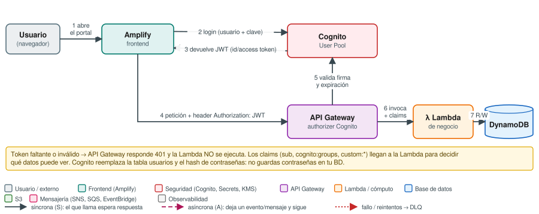</div>

**Cómo se obtiene el token (Cognito)** [EXTRA el detalle; el curso solo dice que Cognito emite los tokens y que se usan al llamar a API Gateway]:

1. El frontend (Amplify) envía usuario y clave a Cognito.
2. Cognito devuelve tokens JWT (id token con datos del usuario y claims; access token para autorizar; refresh token para renovar).
3. El frontend envía el JWT en el header `Authorization` en cada llamada.
4. El **authorizer de Cognito** en API Gateway valida firma y expiración antes de invocar la Lambda (sin token válido → 401).
5. La Lambda recibe los **claims** (`sub`, `cognito:groups`, atributos `custom:*`) para decidir qué datos puede ver.

**Qué necesita cada pieza**: Cognito → User Pool, app client, grupos; API Gateway → authorizer tipo Cognito en cada método; Lambda → leer claims; frontend → guardar el token y enviarlo.

### Caso 2 — Login con token propio (lo que se hizo en el laboratorio, sem. 10) [CURSO]
Se usó porque **Cognito no estaba disponible en AWS Academy**. Son 4 Lambdas y 3 tablas:

<div class="dg">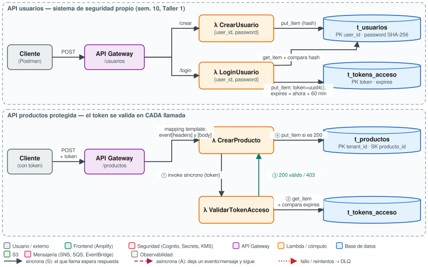</div>

| Paso | Qué hace | Detalle exacto del curso |
|---|---|---|
| Registro (`CrearUsuario`) | Guarda el usuario | `hashlib.sha256(password.encode()).hexdigest()` y `put_item` en `t_usuarios` (PK `user_id`); respuestas 200 / 400 (falta dato) / 500 |
| Login (`LoginUsuario`) | Verifica y genera el token | `get_item` por `user_id`; compara hash con hash; si coincide: `token = str(uuid.uuid4())`, `expires = ahora + timedelta(minutes=60)` formato `%Y-%m-%d %H:%M:%S`, `put_item` en `t_tokens_acceso` (PK `token`); si no: 403 |
| Llamada protegida (`CrearProducto`) | Pide validar antes de actuar | Lee `event['headers']['Authorization']` (llega por la **plantilla de asignación** de API Gateway) e **invoca** `ValidarTokenAcceso` con `RequestResponse` |
| Validación (`ValidarTokenAcceso`) | Decide si el token sirve | `get_item` del token; si no existe → 403 "Token no existe"; si `expires` ya pasó → 403 "Token expirado"; si no → 200 |

**Cómo se saca el token**: el cliente hace `POST /usuarios/login` con `{user_id, password}`; la respuesta trae `{"statusCode": 200, "token": "<uuid>"}`; se guarda y se manda en el header `Authorization` de las demás llamadas. **Por qué es peor que Cognito**: tú mantienes el hash, la expiración y la validación; sin refresh, sin MFA, sin grupos.

### Caso 3 — CRUD de un microservicio
<div class="dg">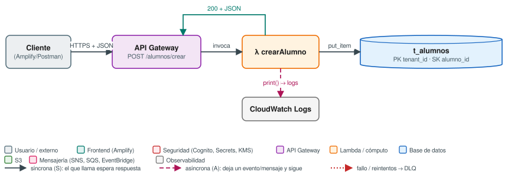</div>

| Operación | Ruta típica | Lambda | Llamada a DynamoDB (boto3) |
|---|---|---|---|
| Crear | `POST /alumnos/crear` | `crearAlumno` | `put_item(Item={...})` |
| Buscar uno | `POST/GET /alumnos/buscar` | `buscarAlumno` | `get_item(Key={'tenant_id':..,'alumno_id':..})` |
| Listar | `POST/GET /alumnos/listar` | `listarAlumnos` | `query(KeyConditionExpression=Key('tenant_id').eq(t))` |
| Modificar | `PUT/POST /alumnos/modificar` | `modificarAlumno` | `update_item(...)` / `put_item` |
| Eliminar | `DELETE/POST /alumnos/eliminar` | `eliminarAlumno` | `delete_item(Key={...})` |

Patrón de cada Lambda del curso: **Entrada (json) → Proceso (boto3) → Salida (json con `statusCode`)**. Cada una necesita rol IAM, timeout (3 s por defecto, los talleres usan 20–30 s), nombre de tabla (mejor en variable de entorno) y CORS habilitado en API Gateway si lo llama un navegador.

### Caso 4 — Subir un archivo y reaccionar
<div class="dg">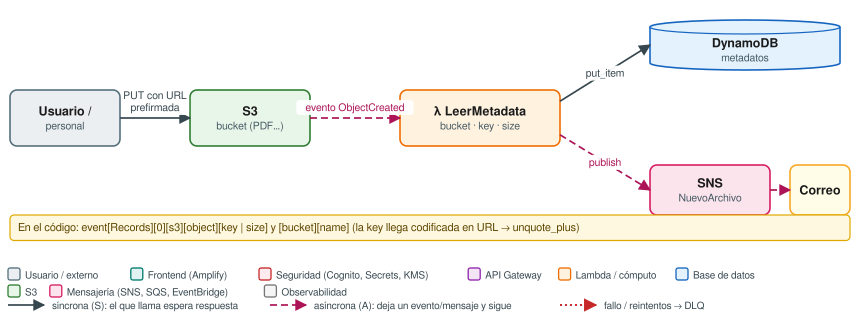</div>

El archivo grande no pasa por API Gateway: el cliente pide una **URL prefirmada** a una Lambda y sube directo a S3 [EXTRA]. S3 emite `ObjectCreated` y dispara la Lambda que lee `key`, `size` y `bucket` (patrón del Taller 2, sem. 13: en el curso el nombre del archivo codifica `curso_id` y `alumno_id`), guarda metadatos en DynamoDB y publica en SNS.

### Caso 5 — Notificar a varios destinatarios sin perder mensajes (fan-out + DLQ)
<div class="dg">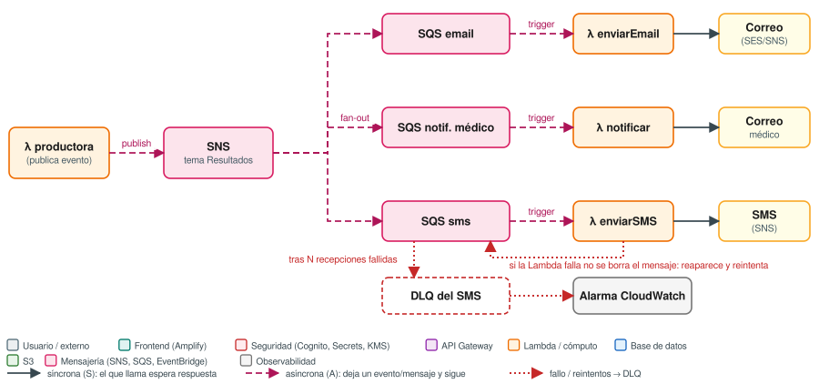</div>

Una Lambda publica **una vez** en SNS; SNS reparte a una cola SQS por consumidor; cada cola dispara su Lambda. **Si una Lambda falla**, el mensaje no se borra, reaparece (en el taller ~30 s) y se reintenta hasta *recepciones máximas*; luego va a la **DLQ**, donde una **alarma de CloudWatch** avisa. Los otros canales no se afectan. SNS puede filtrar por atributos (`tenant_id`) en cada suscripción.

### Caso 6 — Tarea programada (reporte nocturno, sensor simulado)
<div class="dg">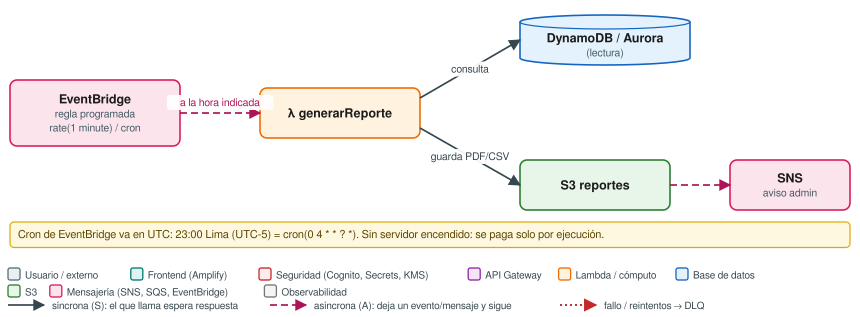</div>

### Caso 7 — Un usuario solo ve sus propios datos
<div class="dg">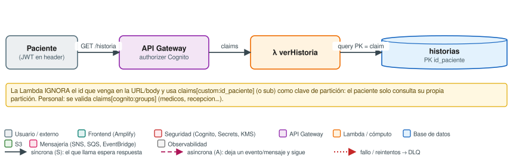</div>

### Caso 8 — Multi-tenancy en la práctica [CURSO, sem. 9]

- Cada tabla DynamoDB lleva `tenant_id` como **clave de partición** (o prefijo: `tenant_id#alumno_id`); cada consulta se acota a un tenant.
- Cada evento SNS lleva `tenant_id` como atributo; cada suscripción filtra por él.
- Para BD relacional: patrón 1 (columna `TENANT_ID`), patrón 2 (un esquema por tenant en un único RDS; el que pide el proyecto final), patrón 3 (una BD por tenant).

### Caso 9 — Qué respondes cuando te preguntan "¿cómo se conectan?"
Siempre en 3 frases: **quién dispara** (trigger), **qué hace** (acción) y **qué deja o manda** (salida). Ejemplo: "S3 dispara la Lambda al crearse un objeto; la Lambda lee clave y tamaño; guarda los metadatos en DynamoDB y publica el evento en SNS".

---

## Parte 4. Reglas para dibujar un buen diagrama

1. **Orden de izquierda a derecha**: usuarios → frontend → seguridad/entrada → cómputo → datos → mensajería/notificaciones.
2. **Un cilindro de BD por microservicio**, dentro del cuadro del microservicio (rotula el tipo: DynamoDB/Aurora).
3. **Etiqueta cada flecha**: verbo o evento + (S)/(A).
4. **Línea sólida = síncrona, punteada = asíncrona**; di la convención en una leyenda.
5. **SNS delante de varios consumidores; SQS delante de cada consumidor que no puede perder mensajes; DLQ junto a cada SQS crítica.**
6. **Agrupa con recuadros** ("Microservicio Citas", "Mensajería", "Seguridad").
7. **Siempre incluye transversales**: CloudWatch (logs/alarmas), IAM mínimo privilegio, KMS/Secrets si hay datos sensibles.
8. **Numera el flujo principal** (1, 2, 3…) y refiérete a esos números en la explicación escrita.
9. **Justifica debajo del diagrama**: una línea "servicio → por qué" por cada elemento no obvio.

---

## Parte 5. Ejemplos resueltos

### Ejemplo 1 — Tienda online con pedidos (caso inventado) [PROPUESTA]
**Requisitos**: cliente compra desde web; se descuenta stock; se cobra; se envía correo de confirmación; los picos de ofertas multiplican las compras; si falla el envío del correo no se debe perder.

**Microservicios**

| Microservicio | Lambdas | BD | Justificación |
|---|---|---|---|
| Catálogo | `listarProductos`, `obtenerProducto` | DynamoDB | lecturas por clave, muy escalable |
| Pedidos | `crearPedido`, `cancelarPedido`, `verPedido` | DynamoDB (PK `cliente_id`, SK `pedido_id`) | acceso por cliente; picos |
| Inventario | `descontarStock`, `reponerStock` | DynamoDB | actualización atómica por producto |
| Pagos | `registrarPago` | Aurora Serverless | transacciones ACID y conciliación |
| Notificaciones | `enviarCorreo` | – | consume eventos |

**Diagrama**
<div class="dg">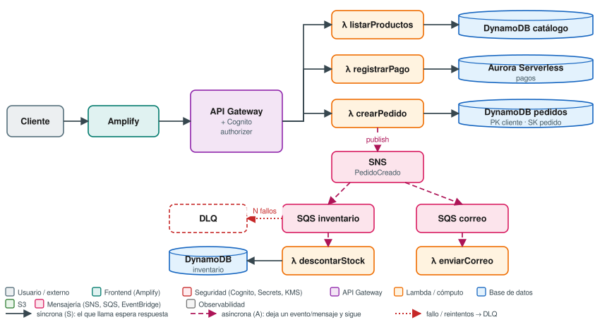</div>
**Flujo**: (1) login Cognito → JWT; (2) `crearPedido` guarda el pedido y publica `PedidoCreado` en SNS; (3) SNS reparte a dos colas; (4) `descontarStock` y `enviarCorreo` consumen a su ritmo; (5) si el correo falla se reintenta y termina en DLQ + alarma, sin perder el pedido.
**Por qué SNS + SQS**: un evento, dos consumidores independientes (fan-out); cada cola protege a su consumidor de picos y caídas (sem. 13–14).

---

### Ejemplo 2 — Telefonía con reporte del cliente (inspirado en tu examen anterior) [PROPUESTA]
**Requisitos**: usuarios, cuentas, beneficios; un reporte PDF por cliente con nombre, edad, cuentas, beneficios; reporte mensual para todos.

| Microservicio | BD | Campos del reporte |
|---|---|---|
| Usuarios | DynamoDB | nombre, fecha_nacimiento (edad se calcula) |
| Cuentas | Aurora (saldos, movimientos transaccionales) | cuentas, saldo, estado |
| Beneficios | DynamoDB | beneficios vigentes |

**Diagrama**
<div class="dg">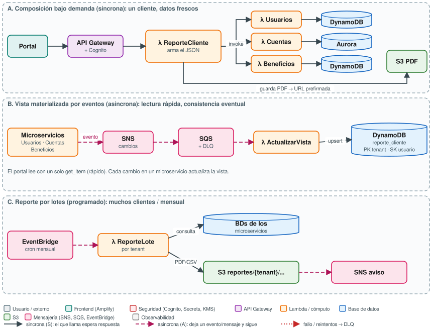</div>
**Justificación**: sin JOIN entre BDs, se **compone** la información en una Lambda (consulta puntual), o se mantiene una **vista materializada** por eventos para lecturas rápidas, o se genera **por lotes** con EventBridge cuando son muchos clientes (ver §13 de la guía).

---

### Ejemplo 3 — Sensores IoT con alertas (basado en el Taller 4 de la sem. 14) [CURSO adaptado]
**Requisitos**: cada minuto una fábrica envía lecturas de CO2; guardar todas; alertar por correo si CO2 > 800 PPM; la fábrica FAB1 también quiere ver sus lecturas en una cola.

<div class="dg">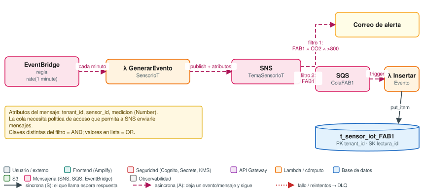</div>
**Qué recordar**: la cola necesita **política de acceso** que permita a SNS escribirle; el filtro vive en la **suscripción**; claves distintas del filtro = AND (sem. 14).

---

### Ejemplo 4 — Universidad / entrega de tareas (basado en las sem. 9, 13) [PROPUESTA con base CURSO]
**Requisitos**: varias universidades (multi-tenant); alumnos suben archivos de tareas; al subir se registran metadatos y se avisa al docente; alta de alumno avisa a Canvas y a Seguridad.

| Microservicio | BD |
|---|---|
| Alumnos | DynamoDB `t_alumnos` (PK `tenant_id`, SK `alumno_id`) — patrón 1 |
| Cursos/Matrículas | DynamoDB con GSI (por alumno y por curso) |
| Archivos | S3 + DynamoDB metadatos |

<div class="dg">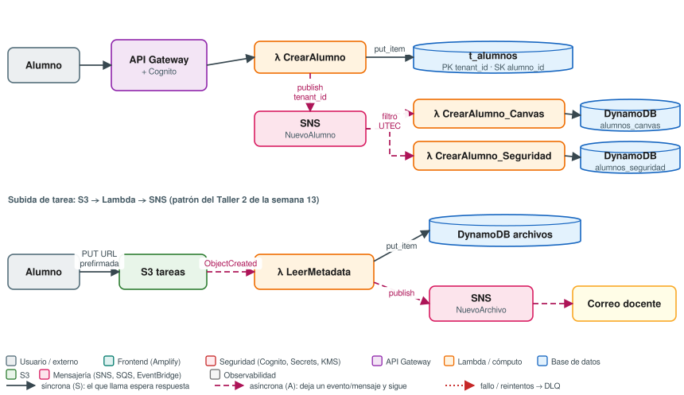</div>
**Justificación**: `tenant_id` como partición aísla a cada universidad (patrón 1); el publicador no conoce a los suscriptores, por eso se pueden añadir consumidores nuevos (Seguridad) sin modificarlo.

---

### Ejemplo 5 — Clínica San Gabriel (examen simulado)
Resuelto completo (microservicios, diagrama, flujos, Cognito, conceptos) en la **guía del examen** que sigue a este manual (§6 y §7). Resumen del diseño: Amplify (2 apps) → Cognito + API Gateway → 8 microservicios con su BD (DynamoDB en Pacientes, Citas, Laboratorio, Farmacia, Hospitalización; Aurora Serverless en Historia clínica y Facturación) → S3 para PDF/rayos X → EventBridge/SNS/SQS con DLQ para notificaciones, stock crítico y reporte nocturno.

---

## Parte 6. Plantilla de justificación (copiar y adaptar)

> **[Servicio]** se usa para **[función]** porque **[requisito del caso]**. Se prefiere sobre **[alternativa]** porque **[razón]**. Recibe **[trigger]**, **[hace X]** y **[manda Y a Z]**.

Ejemplos:

- *SQS delante de `enviarSMS`*: porque el SMS no debe perderse si el proveedor falla; la cola reintenta y, tras N recepciones, envía a la DLQ para revisión; se prefiere sobre invocar la Lambda directo porque protege de picos y caídas.
- *Aurora Serverless en Facturación*: porque requiere transacciones ACID entre factura y pagos y reportes con joins; se prefiere sobre DynamoDB porque los accesos no son solo por clave.
- *EventBridge cron para el reporte*: porque debe ejecutarse a una hora fija sin servidor encendido; se prefiere sobre un cron en una VM porque no se permite EC2 y se paga solo por ejecución.
